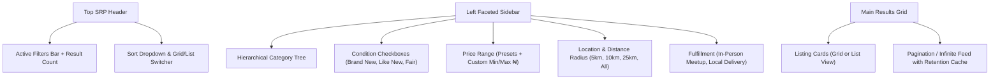
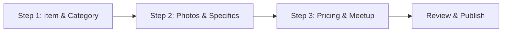
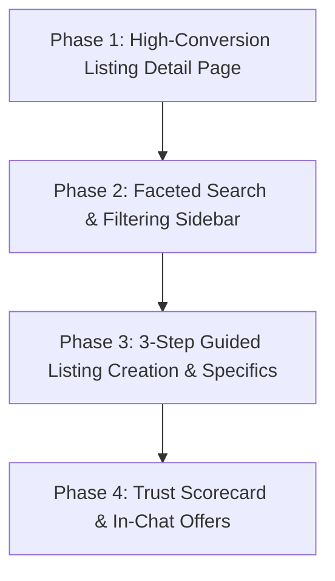

# LocalMarket Modernization Blueprint: eBay-Grade Architecture

An in-depth architectural and UX blueprint derived from live, authenticated analysis of **eBay.com**, tailored specifically for **LocalMarket** (Nigeria, NGN ₦). This document establishes the exact UI components, data structures, and phased implementation path to elevate LocalMarket from a prototype to a trusted, high-conversion marketplace.

---

## 1. Executive Summary: Gap Analysis

| Feature Area | Current LocalMarket State | eBay Gold Standard | Target LocalMarket Architecture |
| :--- | :--- | :--- | :--- |
| **Search & Filtering (`/market`)** | Flat top bar, mode switch, basic category pills | Left faceted sidebar, hierarchical categories, price presets + custom inputs, condition filters, grid/list toggles | Persistent left filter sidebar, instant URL query sync, price sliders, condition pills, grid/list view switcher |
| **Listing Detail (`/listing/:id`)** | Single/basic images, raw text description, contact button | Multi-image zoom gallery, structured key-value specs, buyer protection shield, seller trust matrix, social proof badges | High-res gallery with zoom, structured item specifics table, verified meetup safety guarantee, seller reputation card, "Make Offer" modal |
| **Listing Creation (`/create`)** | Simple single-step form, unstructured text | 3-step guided flow, essential vs optional specifics, condition guidelines, price suggestions, fulfillment config | Guided wizard with drag-and-drop gallery, structured category specs, flaw disclosure prompts, local meetup location presets |
| **User Profile & Trust (`/profile`)** | Basic user info, flat listing list | 12-month feedback scorecard, Detailed Seller Ratings (DSR), dual buyer/seller tabs, verified purchase reviews | Dual profile view (Buyer/Seller), 12-month feedback matrix, 5-star transaction ratings, verified meetup badge |
| **Inbox & Messaging (`/messages`)** | Basic chat thread | Listing context banner, offer negotiation actions, message archive/flagging, safe meetup alerts | Pinned listing card in chat header, instant "Make Offer" / "Accept Offer" action bar, safe meetup location sharing |

---

## 2. Route-by-Route Blueprint

### Route 1: `/market` (Search & Browse Faceted Hub)



#### Key Components to Build:
1. **Faceted Filter Sidebar (`FilterSidebar.jsx`)**:
   - **Category Hierarchy**: Expandable tree with item counts per category.
   - **Buying Format & Type**: Second-hand items, Brand-new goods, Skilled handwork/services.
   - **Condition Filters**: Granular filters matching eBay tiers (*Brand New*, *Like New / Open Box*, *Used - Good*, *Used - Fair*, *For Parts*).
   - **Price Range Widget**: One-click quick brackets (e.g. *Under ₦10,000*, *₦10,000 to ₦50,000*, *₦50,000 to ₦200,000*, *Above ₦200,000*) alongside numeric Min/Max inputs.
   - **Radius & Location Filter**: Radius selection tied to Nigerian towns and GPS coordinates.
   - **Show Only Switches**: Verified sellers only, Items accepting offers, Price-dropped items.
2. **Top View Controller (`MarketToolbar.jsx`)**:
   - Total matching item counter (e.g. *"48 listings found in Lagos"*).
   - View mode toggle buttons (Compact Grid vs Detailed List view).
   - Sort dropdown (*Newest*, *Price: Low to High*, *Price: High to Low*, *Distance: Nearest First*, *Most Popular*).
   - "Save Search" button with instant alert preference.

---

### Route 2: `/listing/:id` (High-Conversion Listing Experience)

#### Layout Architecture:
* **Left Column (60% Desktop)**:
  1. **Interactive Media Gallery**:
     - Main viewport with zoom-on-hover lens.
     - Horizontal/vertical thumbnail carousel supporting up to 12 images.
     - Fullscreen lightroom modal with mobile pinch-to-zoom.
     - Overlaid "Save to Watchlist" floating heart.
  2. **Structured Item Specifics Grid**:
     - Clean 2-column table with bordered key-value pairs (e.g. *Brand*, *Model*, *Storage*, *Color*, *Condition*, *Year of Purchase*).
     - Standardized metadata displayed before unstructured descriptions for quick scanning.
  3. **Detailed Seller Description**:
     - Markdown-supported text with flaws, inclusions, and reason for selling clearly separated.
  4. **Community Safety & Meetup Guide**:
     - Map preview showing approximate neighborhood meetup radius (protects exact home address).
     - Designated public meetup advice (Police stations, busy malls, bank branches).

* **Right Column (40% Desktop - Sticky)**:
  1. **Urgency & Social Proof Badges**:
     - Live badges: *"14 people viewed today"*, *"Listed 2 hours ago"*, *"Only 1 available"*.
  2. **Pricing & Currency Display**:
     - Large bold price in Nigerian Naira (e.g. `₦145,000`).
     - Negotiation badge: *"Accepts Offers"* or *"Fixed Price"*.
  3. **Dual Primary Action Buttons**:
     - Primary button: **Contact Seller / Chat** (opens instant chat thread linked to this listing).
     - Secondary button: **Make an Offer** (opens offer modal with custom ₦ input and suggested price chips at -5%, -10%, -15%).
  4. **Seller Trust Card (`SellerReputationCard.jsx`)**:
     - Avatar with online status indicator.
     - Full member name and location badge.
     - Positive feedback percentage (e.g. `98.6% Positive Feedback`) and total deal count.
     - Average response time badge (*"Replies within 15 minutes"*).
     - Link to *"View all listings by this seller"*.
  5. **Safety & Buyer Protection Shield**:
     - Shield icon: *"Inspect Before Paying Guarantee — Meet in a public place, inspect the item thoroughly, and hand over cash or instant transfer only when 100% satisfied."*

---

### Route 3: `/create` (eBay-Caliber 3-Step Listing Wizard)



#### Step 1: Guided Classification
- Smart title entry with character counter (max 80 chars) and instant category suggestion.
- Category selector with icon badges for Second-hand, Brand-new, and Services.

#### Step 2: Media & Structured Specifics
- **Multi-Photo Drag-and-Drop Uploader**:
  - Up to 12 high-resolution photos.
  - Designated "Cover / Primary Photo" selector.
  - Inline guidance tips (*"Use natural daylight"*, *"Show all angles and serial numbers"*, *"Photograph flaws clearly"*).
- **Condition Grading**:
  - Interactive selection pills with plain-English definitions.
  - Flaw disclosure prompt (*"Does this item have scratches, dents, or battery wear? Disclosing flaws builds buyer trust."*).
- **Dynamic Item Specifics Form**:
  - Dynamically renders relevant attribute inputs based on selected category (e.g., for Vehicles: Mileage, Transmission, Fuel Type; for Phones: Storage, Battery Health, SIM Status).

#### Step 3: Pricing, Negotiation & Fulfillment
- **Pricing Configuration**:
  - Listing price in Naira (`₦`).
  - Toggle: *"Allow buyers to send price offers"*.
  - Minimum acceptable offer threshold (auto-declines lowball spam).
- **Meetup Location & Safe Spots**:
  - Selected city and neighborhood.
  - Preferred public meetup points (e.g. *"Ikeja City Mall"*, *"University Main Gate"*).
  - Optional local delivery radius if seller provides hand-delivery.

---

### Route 4: `/profile` & `/usr/:id` (Seller Dashboard & Reputation Matrix)

#### Components to Implement:
1. **Reputation Scorecard (12-Month Matrix)**:
   - Header summary: Positive %, Member since date, Total verified transactions.
   - Scorecard table:
     - Positive reviews (1 month, 6 months, 12 months)
     - Neutral reviews
     - Negative reviews
2. **Dual-Perspective Tabs**:
   - **Selling Tab**:
     - Active Listings (with edit, mark as sold, and delete actions).
     - Draft Listings (auto-saved unfinished drafts).
     - Sold History (record of past completed transactions).
   - **Buying / Activity Tab**:
     - Watched Listings (saved favorites with price drop indicators).
     - Offers Sent (pending, accepted, or counter-offered).
3. **Verified Reviews Feed**:
   - Customer feedback with star ratings across:
     - Item described accurately
     - Prompt communication
     - Punctual and safe meetup
   - Verified buyer badge on each review.

---

### Route 5: `/messages` (Transactional Chat Hub)

#### Enhanced Communication Layout:
1. **Pinned Listing Banner in Chat**:
   - Thumbnail, title, price, and current status (Available, Pending, Sold) permanently pinned at the top of the chat window.
2. **In-Chat Offer System**:
   - Buyers can tap **"Make Offer"** right from the chat input bar.
   - Renders interactive offer cards directly in the message bubble (*"Buyer offered ₦120,000"*).
   - Seller can tap **Accept**, **Counter-Offer**, or **Decline** with one click.
3. **Safe Meetup Assistant**:
   - Quick action to share designated safe public meetup spot.
   - Built-in reminder: *"Never make an advance transfer before inspecting the goods."*

---

## 3. Data Schema Enhancements

### `Listing` Schema Additions
```javascript
{
  // Structured Specifics
  itemSpecifics: {
    type: Map,
    of: String, // e.g. { brand: 'Apple', storage: '128GB', color: 'Midnight' }
  },
  conditionTier: {
    type: String,
    enum: ['brand_new', 'like_new', 'used_good', 'used_fair', 'for_parts'],
    default: 'used_good',
  },
  flawDescription: { type: String, default: '' },
  
  // Negotiation & Pricing
  acceptsOffers: { type: Boolean, default: true },
  minimumOfferPrice: { type: Number, default: 0 },
  
  // Fulfillment & Safety
  preferredMeetupSpot: { type: String, default: 'Public Location' },
  allowsDelivery: { type: Boolean, default: false },
  
  // Analytics
  viewsCount: { type: Number, default: 0 },
  watchlistCount: { type: Number, default: 0 }
}
```

### `User` Schema Additions
```javascript
{
  feedbackScore: {
    positive: { type: Number, default: 0 },
    neutral: { type: Number, default: 0 },
    negative: { type: Number, default: 0 },
    totalReviews: { type: Number, default: 0 }
  },
  detailedRatings: {
    itemAccuracy: { type: Number, default: 5.0 },
    communication: { type: Number, default: 5.0 },
    punctuality: { type: Number, default: 5.0 }
  },
  verifiedPhone: { type: Boolean, default: false },
  verifiedEmail: { type: Boolean, default: true }
}
```

---

## 4. Phased Implementation Roadmap



* **Phase 1: Listing Detail Page Modernization (`/listing/:id`)**:
  - Image gallery with thumbnail strip and zoom modal.
  - Structured item specifics grid.
  - Prominent "Contact" + "Make Offer" dual CTA.
  - Seller trust card with feedback score and response badge.
  - Safe meetup and inspection guarantee shield.

* **Phase 2: Faceted Marketplace Search (`/market`)**:
  - Left faceted filter sidebar with hierarchical categories.
  - Price brackets with custom Min/Max inputs.
  - Condition checkboxes and location radius sliders.
  - Grid vs List view switcher.

* **Phase 3: Guided Listing Creation Wizard (`/create`)**:
  - 3-step progress stepper (Category -> Details & Photos -> Price & Meetup).
  - Multi-image drag-and-drop uploader with primary selector.
  - Category-tailored item specifics form.
  - Flaw disclosure box and public meetup presets.

* **Phase 4: Reputation Matrix & In-Chat Negotiation (`/profile` & `/messages`)**:
  - 12-month feedback scorecard and verified buyer reviews.
  - Pinned listing banner in message threads.
  - Interactive in-chat offer creation and acceptance flow.

---
*Created as part of the LocalMarket continuous architectural upgrade.*
