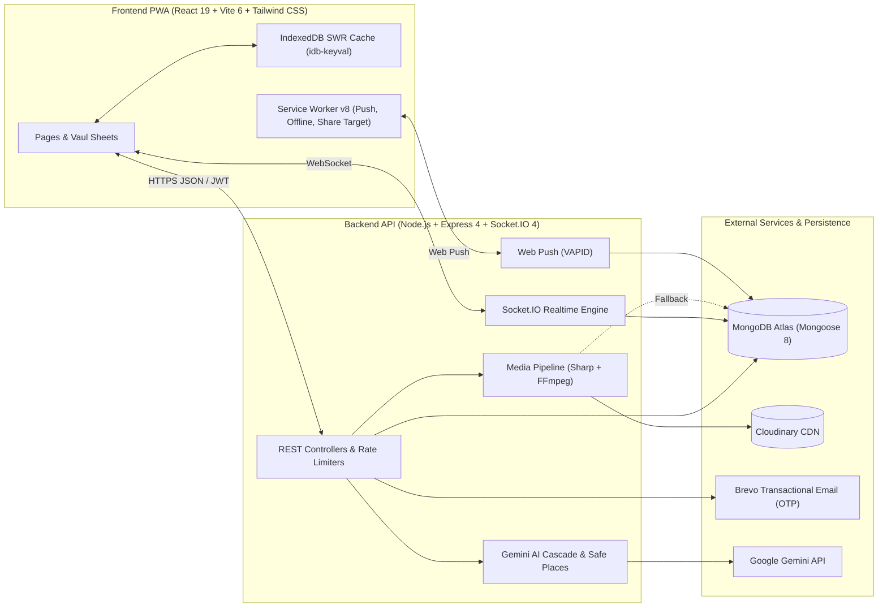

# oBuy - Complete Product & Engineering Overview

> **oBuy** is a Nigerian hyper-local, peer-to-peer community marketplace and Progressive Web App (PWA) for buying and selling **Second-Hand Goods**, shopping **Brand-New Items**, and booking **Local Handwork & Services** with zero platform commission and face-to-face physical inspection before payment.

---

## 1. Core Vision & Product Philosophy

Traditional online marketplaces often charge steep middleman commissions or expose local buyers and sellers to advance-payment scams. **oBuy** was built from scratch around three foundational principles:

1. **Zero-Commission Peer-to-Peer Commerce:** Buyers and sellers negotiate directly in-app and settle payments in person (cash or instant bank transfer) only after inspecting the item or confirming service scope.
2. **Hyper-Local Nigerian Context:** Built natively around Nigerian Naira (`₦` / NGN), Nigerian towns and university/commercial hubs (Uromi, Abraka, Ekpoma, Benin City, Warri, Lagos, and nationwide), distance-radius filtering, and realistic local market pricing.
3. **Native Mobile App Feel on the Open Web:** Engineered as an installable, offline-capable PWA with bottom-tab navigation, Vaul bottom sheets, pull-to-refresh, haptics, voice notes, Web Push alerts, OS Share Target support, and non-zoomable iOS/Android touch ergonomics.

---

## 2. The Three Trading Modes

Every listing on oBuy belongs to one of three distinct trading pillars:

| Mode | Identifier | Typical Inventory | Pricing Models | Card Badge Color |
| :--- | :--- | :--- | :--- | :--- |
| **Second-Hand Goods** | `second-hand` | Pre-owned phones, laptops, generators, furniture, road bikes, tools, graded by condition (`fair`, `good`, `like-new`) | `fixed`, `negotiable` | Friendly Orange (`brand-500`) |
| **Brand-New Items** | `new` | Factory-sealed gadgets, footwear, fashion, home decor, boutique crafts, snacks | `fixed`, `negotiable` | Fresh Emerald (`emerald-600`) |
| **Local Handwork & Services** | `service` | Barbers & hair stylists, solar/electrical engineers, mechanics, phone/laptop repairers, private tutors, cleaners, caterers | `fixed`, `starting-at`, `negotiable` | Crisp Sky Blue (`sky-600`) |

---

## 3. Feature Breakdown

### 3.1 Discovery, Search & Faceted Marketplace
- **Home Showcase ([LandingPage.jsx](frontend/src/pages/LandingPage.jsx)):**
  - Global search bar with category filter and quick `Popular:` shortcuts.
  - Auto-switching 3-slide infinite Hero Carousel (local deals showcase, account benefits banner, neighborhood handwork banner) with manual prev/next, dot indicators, and pause/play controls.
  - Compact 7-tile **Explore by Category** grid, horizontally scrollable **Today's Highlights / Trending Deals Near You** carousel, tilted showcase promo band, 3 trading mode pillars, and the 3-step **How Safe Community Commerce Works** guide.
- **Faceted Marketplace ([HomePage.jsx](frontend/src/pages/HomePage.jsx) & [FilterSidebar.jsx](frontend/src/components/FilterSidebar.jsx)):**
  - Unified 3-column Mode Switcher (`Second-Hand`, `Brand-New`, `Services`), full-width search bar, and a 1-tap horizontal Category Pill strip.
  - Desktop sticky sidebar + Mobile Vaul bottom sheet filters: Price presets & custom Min/Max Naira range, Item Condition, Nigerian Town/Region selector, and Haversine Distance Radius (`Same town` / `km away` tags).
  - Grid and List view toggles, sort options (`Newest`, `Price: Low to High`, `Price: High to Low`, `Most Viewed`), real-time Socket.IO feed sync when listings are created/edited/sold/deleted, and **Load More** pagination (`24` listings per page).
- **Listing Details ([ListingDetailPage.jsx](frontend/src/pages/ListingDetailPage.jsx)):**
  - Full-screen swipeable/clickable photo gallery + [PhotoLightbox.jsx](frontend/src/components/PhotoLightbox.jsx), view counter, watcher count, item specifics, honest cosmetic flaw disclosures, service availability notes, seller trust summary, native Share Sheet (Web Share API + clipboard fallback), Watchlist toggle, and direct `Message Seller to Meet` / `Make an Offer` CTAs.
  - Owners viewing their own listing get inline **Mark Sold / Completed**, **Edit Listing** (`/edit/:id`), and **Manage All My Listings** controls (and cannot message themselves).

### 3.2 Guided 3-Step Seller Wizard & Edit Flow
- **Create & Edit Listing ([CreateListingPage.jsx](frontend/src/pages/CreateListingPage.jsx)):**
  - Powers both `/create` and `/edit/:id` with a live real-time marketplace card preview on desktop.
  - **Step 1 (Item):** Trading mode picker, category selection, listing title, and 1-click **oBuy AI Listing Co-Pilot**.
  - **Step 2 (Photos & Specifics):** Up to 12 photos with drag/drop upload, primary Cover Photo selection, Web Share Target photo intake (`?shared=1`), condition grading, structured item specifics, and honest flaw disclosure.
  - **Step 3 (Pricing & Safe Meetup):** Naira price, pricing model (`Fixed`, `Negotiable / OBO`, `Starting-At`), city/neighborhood, one-click public safe meetup presets, delivery toggle, and Direct Safe Deal Blueprint agreement.

### 3.3 Real-Time Chat, Offers, Voice Notes & Safe Meetups
- **Live Split Inbox ([ChatPage.jsx](frontend/src/pages/ChatPage.jsx) & [chatSocket.js](backend/src/sockets/chatSocket.js)):**
  - Powered by Socket.IO with JWT authentication, live typing/delivery, unread badges, and TikTok-style **Primary** vs **Requests** tabs (new buyers can send up to 5 messages while pending seller acceptance).
  - **Structured Price Offers & Counter-Offers:** Interactive in-chat offer cards with `Accept`, `Counter`, and `Decline` actions, automatic AI Negotiation Tip insights, and post-deal **Mark Listing as Sold** / **Leave Seller Feedback** prompts.
  - **Cross-Platform Voice Notes ([VoiceMessageBubble.jsx](frontend/src/components/VoiceMessageBubble.jsx) & [audioTranscode.js](backend/src/utils/audioTranscode.js)):** Tap-to-record voice notes with Screen Wake Lock (prevents phone sleep while recording), server-side FFmpeg transcoding so iOS Safari and Android/Chrome recordings play back reliably on every device, single-active-audio coordination, and seekable playback scrubbers.
  - **Safety Controls Inside Chat:** Built-in suspicious message detector (flags requests for advance transfers, transport fees, fake alerts, or moving off-platform), Smart Safe Meetup Spot proposals, user blocking/unblocking, conversation deletion, and strict DB/API/UI self-messaging prevention.

### 3.4 Member Profiles, Watchlist & Reputation Scorecard
- **Profiles ([ProfilePage.jsx](frontend/src/pages/ProfilePage.jsx)):** Customizable avatar and cover banner (persisted via Cloudinary), bio, city, verified badge, 4-stat quick bar (`Active`, `Sold`, `Reviews`, `Rating`), and a **12-Month Seller Reputation Scorecard** tracking Item Accuracy, Communication, and Safe Meetup/Punctuality ratings.
- **Favorites ([FavoritesPage.jsx](frontend/src/pages/FavoritesPage.jsx)):** Dedicated saved Watchlist synced to the user account with mode filtering and instant unfavorite.

---

## 4. oBuy AI Suite (Anti-Hallucination & Grounded Design)

All AI capabilities are routed through [geminiClient.js](backend/src/services/geminiClient.js) using `@google/genai` with a resilient multi-model cascade so temporary model quota or latency issues fail over gracefully.

1. **Floating oBuy AI Assistant ([AIAssistantDrawer.jsx](frontend/src/components/AIAssistantDrawer.jsx) -> [aiService.js](backend/src/services/aiService.js)):**
   - Draggable floating launcher (per-viewport saved position) that opens a slide-over assistant drawer.
   - **Strictly DB-Grounded:** Searches live active MongoDB listings and verified sellers, returning clickable mini listing cards with real prices and sellers rather than hallucinating fake inventory.
   - Protected by a dedicated Guest AI rate limit (`guestAiLimiter`) plus authenticated `aiLimiter`.
2. **AI Listing Wizard Co-Pilot (`POST /api/ai/draft-listing`):**
   - Converts a short rough description into a clean title, category-locked specifics, description, honest flaw summary, safe meetup advice, and realistic 3-tier Nigerian Naira market valuation (`Fast Sale`, `Recommended`, `Top Tier`).
3. **Smart Geo-AI Safe Meetup Finder ([safePlacesService.js](backend/src/services/safePlacesService.js)):**
   - Uses GPS coordinates (with city fallback) to discover real public exchange venues (malls, bank forecourts, plazas, police stations) and ranks them strictly by verified `candidateIndex` so zero fake addresses are ever invented.

---

## 5. Native PWA, Offline Support & Device Integration

- **Installable Standalone App:** [manifest.json](frontend/public/manifest.json), custom adaptive/maskable icons, instant branded splash screen in [index.html](frontend/index.html), custom install prompts ([PWAInstallContext.jsx](frontend/src/context/PWAInstallContext.jsx) & [IOSInstallModal.jsx](frontend/src/components/IOSInstallModal.jsx)), and native non-zoomable iOS/mobile touch ergonomics ([main.jsx](frontend/src/main.jsx)).
- **Service Worker (`v8`) & Offline SWR Caching:** [sw.js](frontend/public/sw.js) precaches the app shell and handles push events, notification clicks, and Web Share Target POSTs. [routeCache.js](frontend/src/utils/routeCache.js) backs route feeds and profiles with IndexedDB (`idb-keyval`) so previously visited data renders instantly offline while `OfflineBanner` triggers silent re-sync on reconnect.
- **W3C Web Push & App Icon Badges:** [pushService.js](backend/src/services/pushService.js) auto-generates and persists VAPID keys in MongoDB (`SystemConfig`), dispatches real background push notifications for incoming chats/offers, and updates the home-screen app icon badge count (`navigator.setAppBadge`).
- **3-Layer In-App Permission Center ([PermissionContext.jsx](frontend/src/context/PermissionContext.jsx) & [PermissionsSheet.jsx](frontend/src/components/PermissionsSheet.jsx)):** Manages Notifications, Microphone, Location, and Camera with pre-permission warm prompts and concise OS-specific recovery instructions if a user previously blocked a permission.

---

## 6. Brand Identity & Design System

- **Official Vector Mark ([BrandLogo.jsx](frontend/src/components/BrandLogo.jsx)):** Forward-slanted Turbo-O ring with 3 tapered motion streaks fused with a rounded shopping cart inside the O, paired with a bold dark `Buy` wordmark. Rendered consistently across Navbar, Footer, Favicon, iOS/Android icons, PWA splash, and transactional emails.
- **Centralized Light-Theme Orange Palette ([index.css](frontend/src/index.css)):**
  - Clean pure white (`#FFFFFF`) and light slate (`#F8FAFC`) base surfaces with crisp black prices (`#0F172A`) and dark slate typography.
  - Warm, friendly Orange brand scale (`--brand-500` `#F97316`, `--brand-600` `#EA580C`, `--brand-700` `#C2410C`, airy faded tints `--brand-50` `#FFF8F1` / `--brand-100` `#FFEDD5`) applied intentionally on the logo, primary conversion CTAs, faded outgoing chat/voice bubbles, and `Used` badges.
  - **Semantic Companion Colors:**
    - **Light Emerald (`emerald-50` / `emerald-700`):** Unified across all safety rules, Safe Meetup banners, Photo Tips, Inspection Guarantee, Verified checkmarks, and `New` badges.
    - **Crisp Sky Blue (`sky-600`):** Local `Service` mode badges, subcategory labels, and service pillars.
    - **Real-World Blue (`blue-500`):** Location (`MapPin`, `Navigation`) and navigation (`Compass`) icons.
    - **Rose (`rose-500` / `rose-600`):** Watchlist hearts, recording indicator, and destructive actions.

---

## 7. System Architecture & Tech Stack

### Verified Stack Versions
- **Frontend ([frontend/package.json](frontend/package.json)):** React `19.0.0`, React Router `7.1.3`, Vite `6.0.7`, Tailwind CSS `3.4.17`, Framer Motion `14.14.0`, Vaul `1.1.2`, Lucide React `1.16.0`, Axios `1.7.9`, Socket.IO Client `4.8.1`, `idb-keyval` `6.3.0`.
- **Backend ([backend/package.json](backend/package.json)):** Express `4.21.2`, Mongoose `8.9.5`, Socket.IO `4.8.1`, `@google/genai` `3.6.1`, Cloudinary `2.11.0`, Sharp `0.35.5`, `@ffmpeg-installer/ffmpeg` `1.1.0`, `web-push` `4.0.0`, `bcryptjs` `3.0.2`, `jsonwebtoken` `9.0.2`, Helmet `8.0.0`, `express-rate-limit` `7.5.0`, Multer `1.4.5-lts.1`, Validator `13.12.0`.

---

## 8. Frontend Routes & Backend API Surface

### Frontend Routes ([App.jsx](frontend/src/App.jsx))
| Route | Page Component | Purpose |
| :--- | :--- | :--- |
| `/` | `LandingPage` | Editorial home, search bar, 3-slide hero, categories, trending deals, safety guide |
| `/market` | `HomePage` | Faceted marketplace feed, 3-mode switcher, category pills, radius filters, pagination |
| `/listing/:id` | `ListingDetailPage` | Full photo gallery, specifics, seller trust card, chat/offer CTAs, owner controls |
| `/create` | `CreateListingPage` | 3-step listing creation wizard with AI Co-Pilot & Share Target intake |
| `/edit/:id` | `CreateListingPage` | Full edit flow for existing owner listings |
| `/messages` | `ChatPage` | Real-time Socket.IO inbox, offers, voice notes, safe meetup proposals, safety alerts |
| `/profile`, `/profile/:userId`, `/usr/:userId` | `ProfilePage` | Own & public member profiles, cover/avatar uploads, listings, watchlist, reputation scorecard |
| `/favorites` | `FavoritesPage` | Saved watchlist items with mode filters |
| `/login`, `/register` | `AuthRouteRedirect` | Opens unified `AuthModal` (email/password + 6-digit OTP signup & password reset) |

### Backend REST API ([server.js](backend/src/server.js))
| Base Path | Key Endpoints |
| :--- | :--- |
| `/api/auth` | `POST /register`, `/login`, `/refresh`, `/logout`, `/send-signup-otp`, `/verify-signup-otp`, `/forgot-password-otp`, `/reset-password-otp`, `/resend-otp`; `GET/PUT /me` |
| `/api/listings` | `GET /` (paginated/filtered), `/user/my-listings`, `/user/favorites`, `/:id`; `POST /`, `/:id/favorite`; `PUT /:id`; `PATCH /:id/status`; `DELETE /:id` |
| `/api/chat` | `GET /unread-count`, `/conversations`, `/conversations/:id/messages`, `/blocked-users`; `POST /conversations`, `/conversations/:id/messages`, `/block/:userId`, `/unblock/:userId`, `/suggest-safe-spots`; `PATCH /messages/:id/offer`, `/conversations/:id/accept`, `/decline`; `DELETE /conversations/:id` |
| `/api/users` | `GET /:id/profile`, `/:id/listings`, `/:id/reviews`; `POST /:id/reviews` |
| `/api/ai` | `POST /chat` (DB-grounded assistant), `POST /draft-listing` (Co-Pilot) |
| `/api/upload` & `/api/media` | `POST /api/upload` (Sharp-optimized WebP images -> Cloudinary), `POST /api/upload/audio` (FFmpeg-transcoded voice notes), `GET /api/media/:filename` (MongoDB fallback) |
| `/api/notifications` | `GET /vapid-public-key`; `POST /subscribe`, `/test`; `DELETE /unsubscribe` |
| `/api/reports` | `POST /` (user/listing report); `GET /` (admin/moderator review) |
| System | `GET /`, `GET /api/health`, `GET /brand-icon.png` |

---

## 9. Database Models, Media Pipeline & Security

### MongoDB Collections (`backend/src/models/`)
- **`User`:** Account identity, hashed password, avatar/cover URLs, bio, city & GeoJSON coordinates, favorites, blocked users, Web Push subscriptions, refresh tokens.
- **`Listing`:** Mode, title, description, price & priceType, condition/serviceType, category, `itemSpecifics`, flaw disclosure, meetup advice, images array, GeoJSON location, status (`active`/`sold`/`completed`/`inactive`), view/favorite counters, plus **4 compound indexes** for fast filtered & paginated queries.
- **`Conversation` & `Message`:** Strict two-distinct-participant validation (blocks self-messaging at the schema layer), `primary`/`pending` request status, text/offer/meetup/voice/system message types.
- **`Review`:** Positive/neutral/negative rating, star score, item accuracy, communication, and punctuality breakdown.
- **`Otp`, `Report`, `Media`, `SystemConfig`:** Expiring 6-digit OTPs, moderation reports, fallback binary media, and persisted VAPID key pairs.

### Media Storage & Automatic Orphan Cleanup
- [mediaStorageService.js](backend/src/services/mediaStorageService.js) optimizes uploaded photos to WebP via `sharp` and uploads images and FFmpeg-transcoded voice audio to **Cloudinary** (falling back seamlessly to MongoDB `Media` if Cloudinary env vars are absent).
- Deleting a listing, replacing listing photos during `/edit/:id`, or updating/removing a user's avatar or cover image automatically deletes orphaned assets from Cloudinary so storage never bloats.

### Security & Deployment Hardening
- **Auth & Verification:** Short-lived JWT access tokens + refresh token rotation, `bcryptjs` password hashing, and Brevo 6-digit email OTP verification for signup and password resets ([email.js](backend/src/utils/email.js)).
- **Network & Input Defense:** Helmet security headers, strict environment-controlled CORS origin allowlisting (`ALLOWED_ORIGINS` / `CORS_STRICT_MODE`), NoSQL injection key sanitization (`sanitize.js`), malformed JSON -> `400` and invalid price query validation (zero unexpected `500`s), and tiered `express-rate-limit` protections across Auth, OTP, Uploads, Listing Creation, Guest AI, and global API routes.
- **Production Hosting Targets:** Frontend deployed to Vercel (SPA + PWA static assets), Backend deployed to Render (`marketplace-5wy3.onrender.com`), Database on MongoDB Atlas, Media on Cloudinary, Emails via Brevo.
